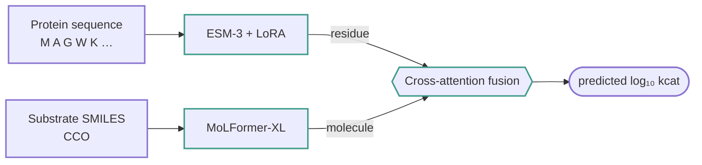
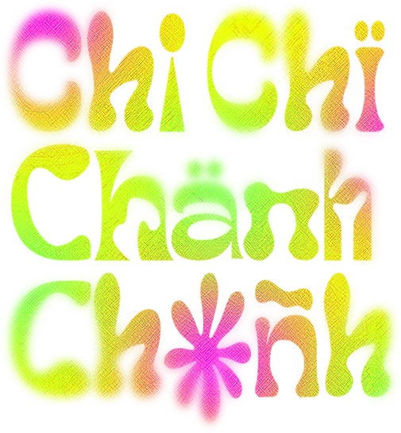
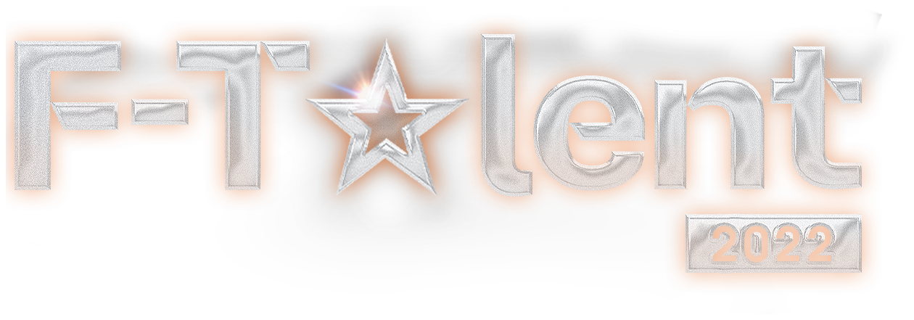
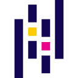

<div align="center">

<samp>PERCEPTION · REASONING · DISCOVERY</samp>

# Thanh Bình.

**Call me Tabi.** From visual signals to biological insight.

`AI / Agents` &nbsp; `Machine Learning` &nbsp; `Bioinformatics`

<samp><a href="https://github.com/ThanhBinh-IwtR">GitHub</a> / <a href="#vision-in-practice">Selected work</a> / <a href="#the-biological-direction">Bioinformatics</a></samp>

</div>

## A little about me

```js
const binh = {
  alias: "Tabi",
  focus: [
    "AI & Computer Vision",
    "ML for Biology"
  ],
  exploring: "Agentic AI",
  also: "Web applications"
};
```

I build across computer vision, multimodal AI and machine learning for biological data.

- **AI & computer vision**: perception, speech and assistive AI systems.
- **Bioinformatics**: protein language models and enzyme kinetics.
- **Web**: client landing pages and AI applications.

## Vision, in practice

<table>
<tr>
<td width="50%" valign="top">

<samp>MULTIMODAL AI</samp>

### [NAVISIGHT ↗](https://github.com/ThanhBinh-IwtR/CAPSTONE_25_SP_NAVISIGHT)

A vision assistant for visually impaired users, combining object detection, depth estimation, voice interaction and spoken guidance.

`PyTorch` `YOLO11` `Depth Anything v2` `Whisper`

<sub>Assistive AI · Vision × Speech</sub>

</td>
<td width="50%" valign="top">

<samp>SIGN LANGUAGE AI</samp>

### [ViSL ↗](https://github.com/ThanhBinh-IwtR/ViSL)

Vietnamese sign-language recognition using hand, face and pose landmarks with a custom PyTorch Transformer and web interface.

`PyTorch` `MediaPipe` `Transformer` `FastAPI`

<sub>Accessibility · Sequence modeling</sub>

</td>
</tr>
</table>

## The biological direction

<samp>BIOINFORMATICS · MOLECULAR ML</samp>

### [K-ICM ↗](https://github.com/ThanhBinh-IwtR/K-ICM)

Predicting enzyme turnover from protein sequences and substrate SMILES with protein and molecular language models and cross-attention fusion.

`ESM-3` `LoRA` `MoLFormer-XL` `PyTorch Lightning` `OOD evaluation`



<sub>[Explore the research code ↗](https://github.com/ThanhBinh-IwtR/K-ICM)</sub>

## Built for people &amp; brands

<table>
<tr>
<td width="33%" align="center" valign="top">

<a href="https://github.com/ThanhBinh-IwtR/Chi-Chi-Chanh-Chanh"></a>

**[Chi Chi Chành Chành ↗](https://github.com/ThanhBinh-IwtR/Chi-Chi-Chanh-Chanh)**

A cultural event landing page bringing the programme, activities and partners together.

<sub>Events · HTML / CSS / JS</sub>

</td>
<td width="33%" align="center" valign="top">

<a href="https://github.com/ThanhBinh-IwtR/F_Talent2022"></a>

**[F-Talent 2022 ↗](https://github.com/ThanhBinh-IwtR/F_Talent2022)**

A talent competition website with judges, event schedules, galleries and registration links.

<sub>Events · HTML / CSS / JS</sub>

</td>
<td width="33%" align="center" valign="top">

<a href="https://github.com/ThanhBinh-IwtR/kierabeauty"></a>

**[Kiera Nguyen Beauty Care ↗](https://github.com/ThanhBinh-IwtR/kierabeauty)**

A beauty business website presenting services, pricing, imagery and booking contact points.

<sub>Business · HTML / CSS / JS</sub>

</td>
</tr>
</table>

<p align="center"><sub>More work: <a href="https://github.com/ThanhBinh-IwtR/ViSL_website">ViSL website</a> · <a href="https://github.com/ThanhBinh-IwtR/Portfolio">Portfolio</a> · <a href="https://github.com/ThanhBinh-IwtR/BHXH-KHANH-HOA">Insurance RAG demo</a></sub></p>

## Tools behind the work

<p align="center">
  &nbsp;
  &nbsp;
  &nbsp;
  &nbsp;
  &nbsp;
  &nbsp;
  &nbsp;
  
</p>

| Area | Tools |
| :-- | :-- |
| **Deep learning** | `PyTorch` `TensorFlow` `Lightning` `Transformers` `PEFT / LoRA` `CUDA` `DDP` `Cross-attention` |
| **Vision / audio** | `YOLO11` `Depth Anything v2` `OpenCV` `MediaPipe` `Faster Whisper` `Wav2Vec2` `OpenAI` `ElevenLabs` |
| **Bio / molecular** | `ESM-3` `MoLFormer-XL` `RDKit` `SMILES` `OOD evaluation` |
| **Data / science** | `Python` `NumPy` `pandas` `scikit-learn` `SciPy` `Matplotlib` `W&B` `Jupyter` |
| **Web / delivery** | `FastAPI` `Next.js` `React` `TypeScript` `Django` `Supabase` `pgvector` `Git` |

## Learning in public

<!-- activity:start -->
<!-- Generated by scripts/update_activity.py; edits inside this block are overwritten. -->

| Contributions | Active days | Current streak | Longest streak | Public repos |
| :---: | :---: | :---: | :---: | :---: |
| **25** | 11 | 1 day | 3 days | 26 |

```text
Oct 2025    3  ██████████▌
Nov 2025    0  ·
Dec 2025    0  ·
Jan 2026    0  ·
Feb 2026    0  ·
Mar 2026    4  █████████████▌
Apr 2026    3  ██████████▌
May 2026    0  ·
Jun 2026    0  ·
Jul 2026    7  ████████████████████████
Aug 2026    0  ·
Sep 2026    2  ███████
Oct 2026    6  ████████████████████▌
```

<sub>Oct 2025 – Oct 2026 · contributions per month from the public calendar of <a href="https://github.com/ThanhBinh-IwtR">ThanhBinh-IwtR</a> · checked daily by GitHub Actions</sub>
<!-- activity:end -->

<br>
<p align="center"><samp>Curiosity → experiments → useful tools.<br>Tabi · AI / Vision / Bioinformatics</samp></p>
