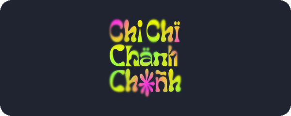
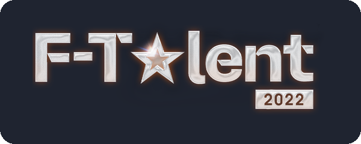
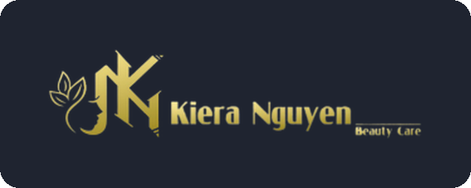

<p align="center">
  
</p>

<h1 align="center">Thanh Bình.<br><sub><sub><i>Call me Tabi</i></sub></sub></h1>

<p align="center">
  From visual signals to biological insight.<br>
  <a href="#vision-in-practice">Selected work</a>&nbsp; / &nbsp;<a href="#the-biological-direction">Bioinformatics</a>&nbsp; / &nbsp;<a href="#learning-in-public">Activity</a>
</p>

## A little about me

I build across computer vision, multimodal AI and machine learning for biological data.

<table>
<tr>
<td width="46%" valign="top">

```js
const tabi = {
  name: "Thanh Bình",
  vision: [
    "perception", "speech",
    "assistive AI systems",
  ],
  biology: [
    "protein language models",
    "enzyme kinetics",
  ],
  web: [
    "client landing pages",
    "AI applications",
  ],
  exploring: "agentic AI",
};
```

</td>
<td width="54%" valign="top">


<sub>Where my commits go, by field. Recent commits weigh more, and the chart is recalculated every day from my public repositories.</sub>

</td>
</tr>
</table>

## Vision, in practice

<table>
<tr>
<td width="50%" valign="top">

<a href="https://github.com/ThanhBinh-IwtR/CAPSTONE_25_SP_NAVISIGHT"></a>

### [NAVISIGHT](https://github.com/ThanhBinh-IwtR/CAPSTONE_25_SP_NAVISIGHT)

A vision assistant for visually impaired users, combining object detection, depth estimation, voice interaction and spoken guidance.

`PyTorch` `YOLO11` `Depth Anything v2` `Whisper`

</td>
<td width="50%" valign="top">

<a href="https://github.com/ThanhBinh-IwtR/ViSL"></a>

### [ViSL](https://github.com/ThanhBinh-IwtR/ViSL)

Vietnamese sign-language recognition using hand, face and pose landmarks with a custom PyTorch Transformer and web interface.

`PyTorch` `MediaPipe` `Transformer` `FastAPI`

</td>
</tr>
</table>

## The biological direction

<table>
<tr>
<td width="100%" valign="top">

<a href="https://github.com/ThanhBinh-IwtR/K-ICM"></a>

### [K-ICM](https://github.com/ThanhBinh-IwtR/K-ICM)

Predicting enzyme kinetic parameters, such as the turnover number k<sub>cat</sub>, for an enzyme and its substrate, straight from the protein sequence and the substrate's chemical structure.

`Enzyme kinetics` `Bioinformatics` `Cheminformatics` `PyTorch Lightning`

</td>
</tr>
</table>

## Built for people &amp; brands

<table>
<tr>
<td width="33%" valign="top">

<a href="https://github.com/ThanhBinh-IwtR/Chi-Chi-Chanh-Chanh"></a>

**[Chi Chi Chành Chành](https://github.com/ThanhBinh-IwtR/Chi-Chi-Chanh-Chanh)**

Landing page for a cultural event, with its programme, activities and partners.

`HTML` `CSS` `JavaScript`

</td>
<td width="33%" valign="top">

<a href="https://github.com/ThanhBinh-IwtR/F_Talent2022"></a>

**[F-Talent 2022](https://github.com/ThanhBinh-IwtR/F_Talent2022)**

Website for a talent show, with judges, schedules, galleries and sign-up.

`HTML` `CSS` `JavaScript`

</td>
<td width="33%" valign="top">

<a href="https://github.com/ThanhBinh-IwtR/kierabeauty"></a>

**[Kiera Nguyen Beauty Care](https://github.com/ThanhBinh-IwtR/kierabeauty)**

Website for a beauty business, with its services, pricing and a way to book.

`HTML` `CSS` `JavaScript`

</td>
</tr>
</table>

<p align="center"><sub>More work: <a href="https://github.com/ThanhBinh-IwtR/ViSL_website">ViSL website</a>, <a href="https://github.com/ThanhBinh-IwtR/Portfolio">Portfolio</a> and an <a href="https://github.com/ThanhBinh-IwtR/BHXH-KHANH-HOA">insurance RAG demo</a>.</sub></p>

## Tools behind the work

<p align="center">
  &nbsp;
  &nbsp;
  &nbsp;
  &nbsp;
  &nbsp;
  &nbsp;
  &nbsp;
  
</p>

<table>
<tr><td width="160"><b>Deep learning</b></td><td><code>PyTorch</code> <code>TensorFlow</code> <code>Lightning</code> <code>Transformers</code> <code>PEFT / LoRA</code> <code>CUDA</code> <code>DDP</code> <code>Cross‑attention</code></td></tr>
<tr><td><b>Vision and audio</b></td><td><code>YOLO11</code> <code>Depth Anything v2</code> <code>OpenCV</code> <code>MediaPipe</code> <code>Faster Whisper</code> <code>Wav2Vec2</code> <code>OpenAI</code> <code>ElevenLabs</code></td></tr>
<tr><td><b>Molecular ML</b></td><td><code>ESM-3</code> <code>MoLFormer-XL</code> <code>RDKit</code> <code>SMILES</code> <code>OOD evaluation</code></td></tr>
<tr><td><b>Data science</b></td><td><code>Python</code> <code>NumPy</code> <code>pandas</code> <code>scikit-learn</code> <code>SciPy</code> <code>Matplotlib</code> <code>W&amp;B</code> <code>Jupyter</code></td></tr>
<tr><td><b>Web delivery</b></td><td><code>FastAPI</code> <code>Next.js</code> <code>React</code> <code>TypeScript</code> <code>Django</code> <code>Supabase</code> <code>pgvector</code> <code>Git</code></td></tr>
</table>

## Learning in public

<!-- activity:start -->
<!-- Generated by scripts/update_activity.py; edits inside this block are overwritten. -->

| Contributions | Active days | Current streak | Longest streak | Public repos |
| :---: | :---: | :---: | :---: | :---: |
| **27** | 13 | 1 day | 3 days | 26 |


<sub>The last 12 months on the public contribution calendar of <a href="https://github.com/ThanhBinh-IwtR">ThanhBinh-IwtR</a>, checked daily by GitHub Actions.</sub>

<picture>
  <source media="(prefers-color-scheme: dark)" srcset="assets/snake-dark.svg">
  
</picture>
<!-- activity:end -->

<br>
<p align="center"><sub>Curiosity → experiments → useful tools.</sub></p>
