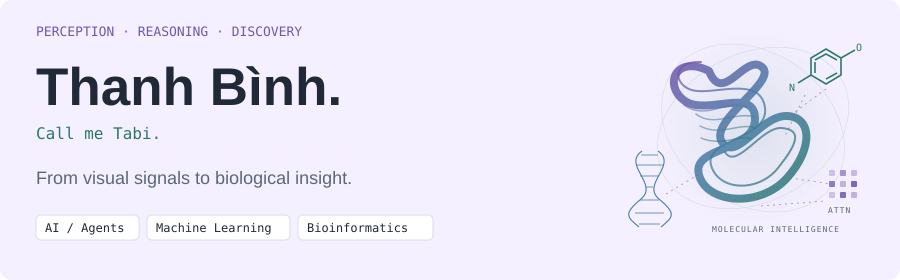
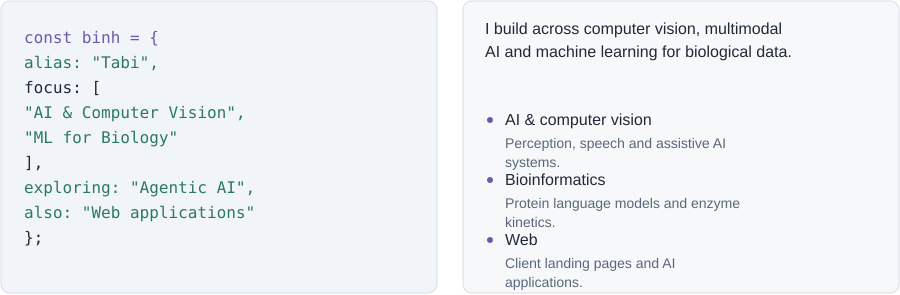
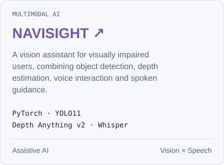
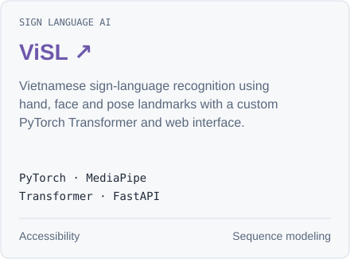
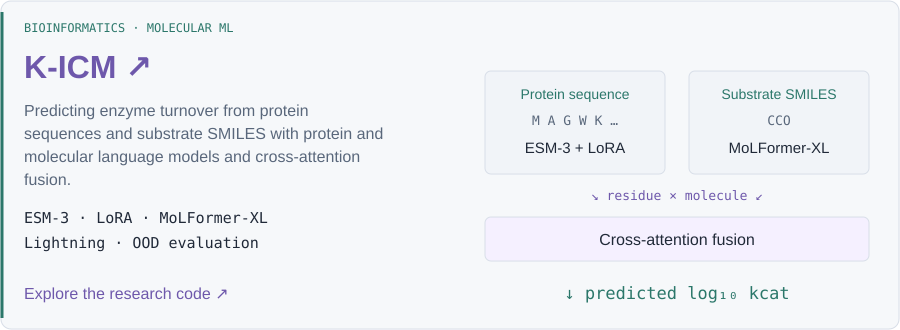
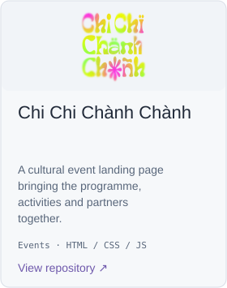
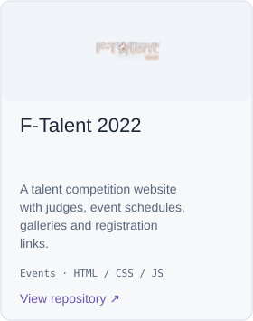
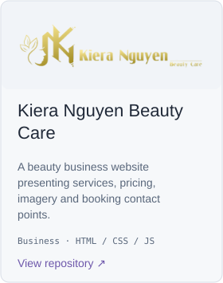
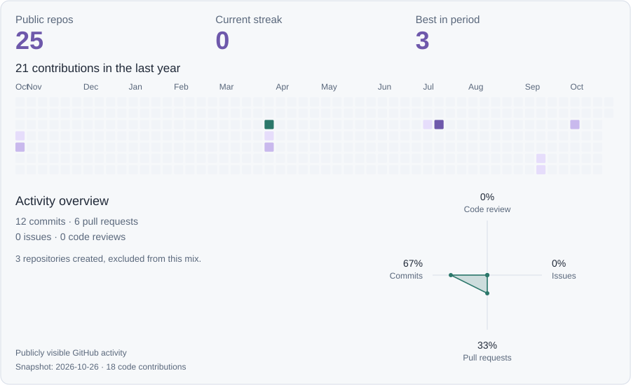

<picture>
  <source media="(max-width: 600px) and (prefers-color-scheme: dark)" srcset="assets/banner-mobile-dark.svg">
  <source media="(max-width: 600px)" srcset="assets/banner-mobile-light.svg">
  <source media="(prefers-color-scheme: dark)" srcset="assets/banner-dark.svg">
  
</picture>

  <samp><a href="https://github.com/ThanhBinh-IwtR">GitHub</a> / <a href="#vision-in-practice">Selected work</a> / <a href="#the-biological-direction">Bioinformatics</a></samp>

## A little about me

<picture>
  <source media="(max-width: 600px) and (prefers-color-scheme: dark)" srcset="assets/intro-mobile-dark.svg">
  <source media="(max-width: 600px)" srcset="assets/intro-mobile-light.svg">
  <source media="(prefers-color-scheme: dark)" srcset="assets/intro-dark.svg">
  
</picture>

## Vision, in practice

  <a href="https://github.com/ThanhBinh-IwtR/CAPSTONE_25_SP_NAVISIGHT"><picture>
    <source media="(max-width: 600px) and (prefers-color-scheme: dark)" srcset="assets/navisight-mobile-dark.svg">
    <source media="(max-width: 600px)" srcset="assets/navisight-mobile-light.svg">
    <source media="(prefers-color-scheme: dark)" srcset="assets/navisight-dark.svg">
    
  </picture></a>
  <a href="https://github.com/ThanhBinh-IwtR/ViSL"><picture>
    <source media="(max-width: 600px) and (prefers-color-scheme: dark)" srcset="assets/visl-mobile-dark.svg">
    <source media="(max-width: 600px)" srcset="assets/visl-mobile-light.svg">
    <source media="(prefers-color-scheme: dark)" srcset="assets/visl-dark.svg">
    
  </picture></a>

## The biological direction

<a href="https://github.com/ThanhBinh-IwtR/K-ICM"><picture>
  <source media="(max-width: 600px) and (prefers-color-scheme: dark)" srcset="assets/bio-mobile-dark.svg">
  <source media="(max-width: 600px)" srcset="assets/bio-mobile-light.svg">
  <source media="(prefers-color-scheme: dark)" srcset="assets/bio-dark.svg">
  
</picture></a>

## Built for people &amp; brands

  <a href="https://github.com/ThanhBinh-IwtR/Chi-Chi-Chanh-Chanh"><picture>
    <source media="(max-width: 600px) and (prefers-color-scheme: dark)" srcset="assets/chichi-mobile-dark.svg">
    <source media="(max-width: 600px)" srcset="assets/chichi-mobile-light.svg">
    <source media="(prefers-color-scheme: dark)" srcset="assets/chichi-dark.svg">
    
  </picture></a>
  <a href="https://github.com/ThanhBinh-IwtR/F_Talent2022"><picture>
    <source media="(max-width: 600px) and (prefers-color-scheme: dark)" srcset="assets/ftalent-mobile-dark.svg">
    <source media="(max-width: 600px)" srcset="assets/ftalent-mobile-light.svg">
    <source media="(prefers-color-scheme: dark)" srcset="assets/ftalent-dark.svg">
    
  </picture></a>
  <a href="https://github.com/ThanhBinh-IwtR/kierabeauty"><picture>
    <source media="(max-width: 600px) and (prefers-color-scheme: dark)" srcset="assets/kiera-mobile-dark.svg">
    <source media="(max-width: 600px)" srcset="assets/kiera-mobile-light.svg">
    <source media="(prefers-color-scheme: dark)" srcset="assets/kiera-dark.svg">
    
  </picture></a>

More work: <a href="https://github.com/ThanhBinh-IwtR/ViSL_website">ViSL website</a> · <a href="https://github.com/ThanhBinh-IwtR/Portfolio">Portfolio</a> · <a href="https://github.com/ThanhBinh-IwtR/BHXH-KHANH-HOA">Insurance RAG demo</a>

## Tools behind the work

  &nbsp;
  &nbsp;
  &nbsp;
  &nbsp;
  &nbsp;
  &nbsp;
  &nbsp;
  

**Deep learning** · PyTorch · TensorFlow · Lightning · Transformers · PEFT / LoRA · CUDA / DDP · Cross-attention

**Vision / audio** · YOLO11 · Depth Anything v2 · OpenCV · MediaPipe · Faster Whisper · Wav2Vec2 · OpenAI / ElevenLabs

**Bio / molecular** · ESM-3 · MoLFormer-XL · RDKit · SMILES · OOD evaluation

**Data / delivery** · NumPy · pandas · scikit-learn · SciPy · Matplotlib · W&amp;B · Jupyter · FastAPI · Next.js / React · TypeScript · Django · Supabase / pgvector · Git

## Learning in public

<a href="https://github.com/ThanhBinh-IwtR"><picture>
  <source media="(max-width: 600px) and (prefers-color-scheme: dark)" srcset="assets/activity-mobile-dark.svg">
  <source media="(max-width: 600px)" srcset="assets/activity-mobile-light.svg">
  <source media="(prefers-color-scheme: dark)" srcset="assets/activity-dark.svg">
  
</picture></a>

  
Contribution snake

  <picture>
    <source media="(prefers-color-scheme: dark)" srcset="assets/snake-dark.svg">
    
  </picture>

 

<samp>Curiosity → experiments → useful tools. Tabi · AI / Vision / Bioinformatics</samp>

